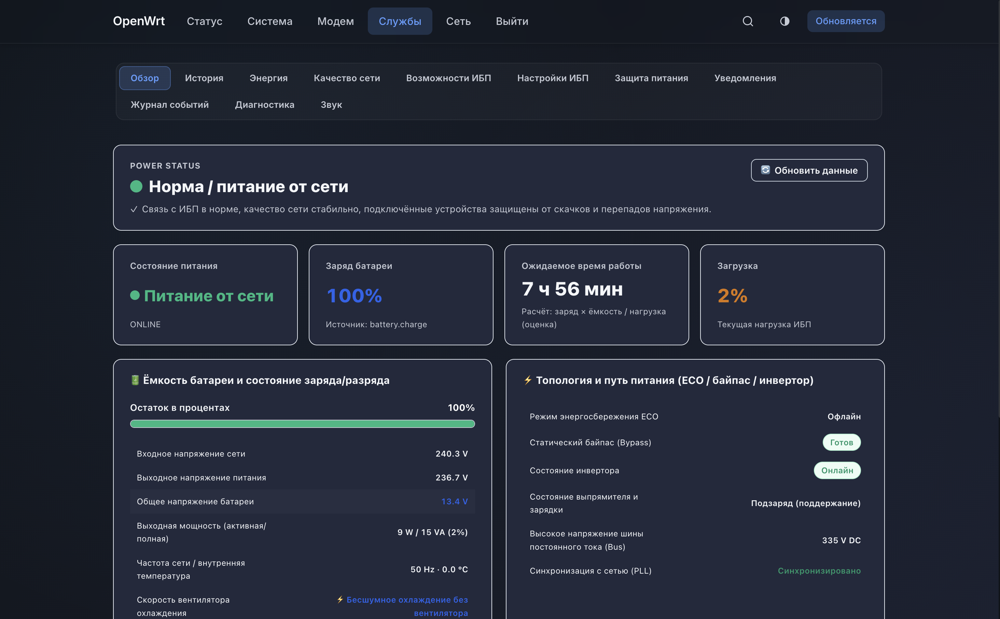
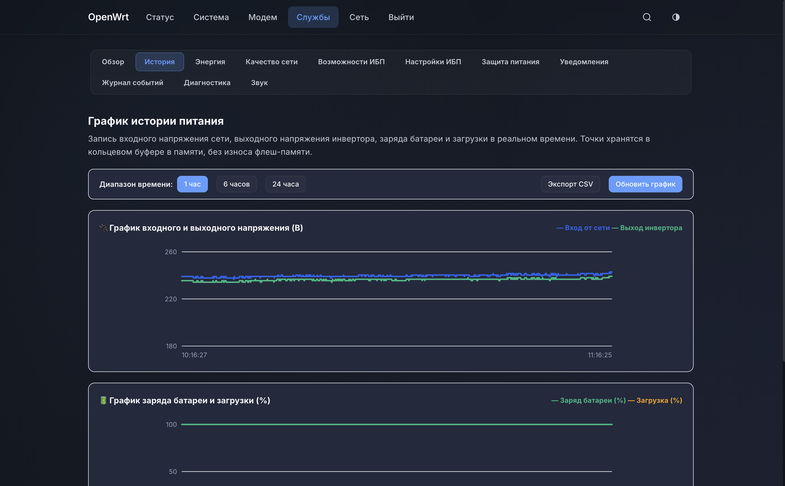
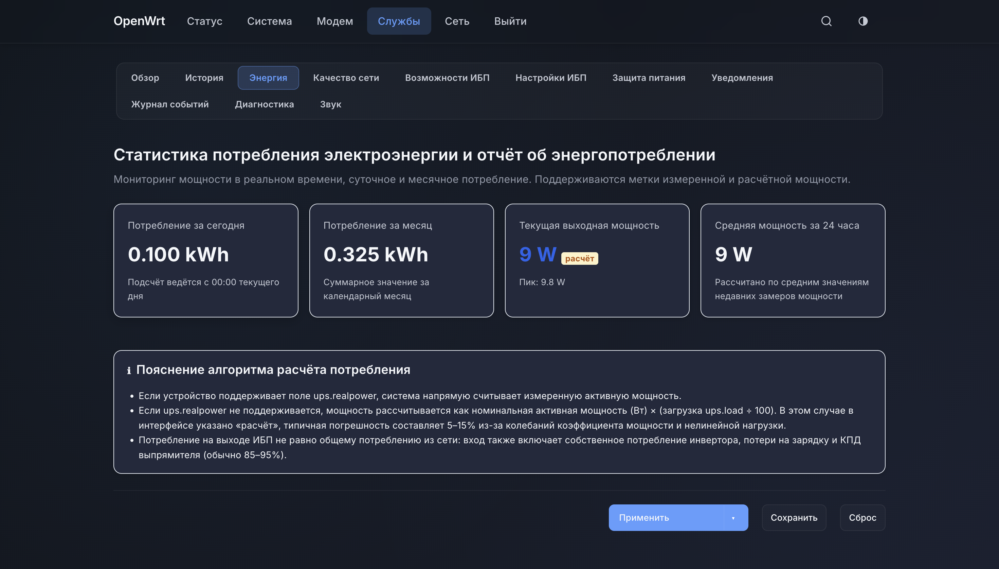
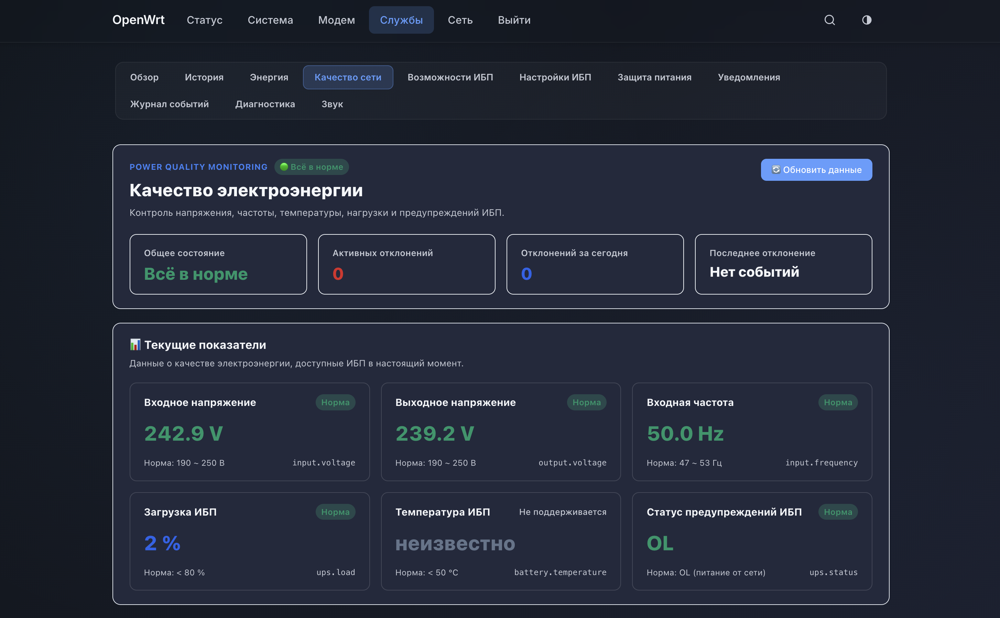
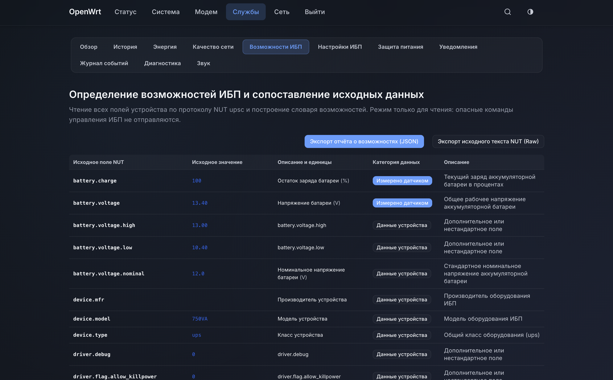
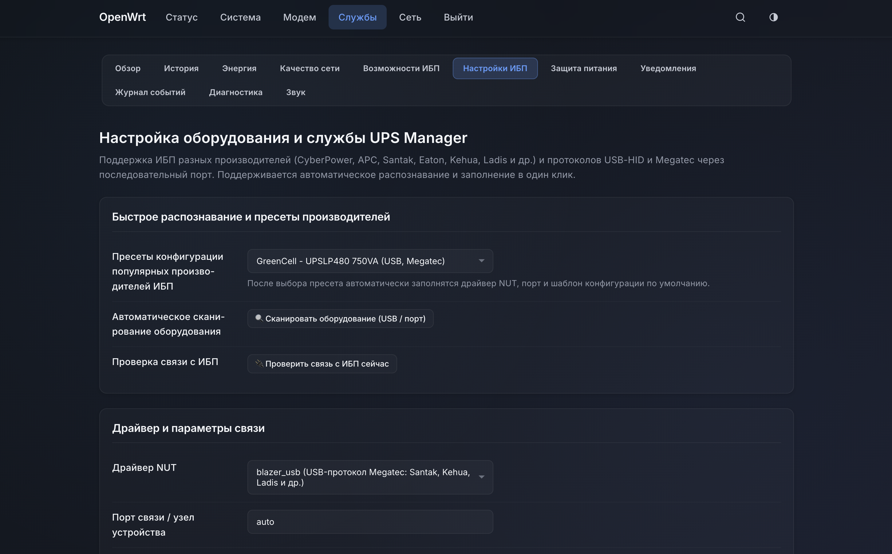
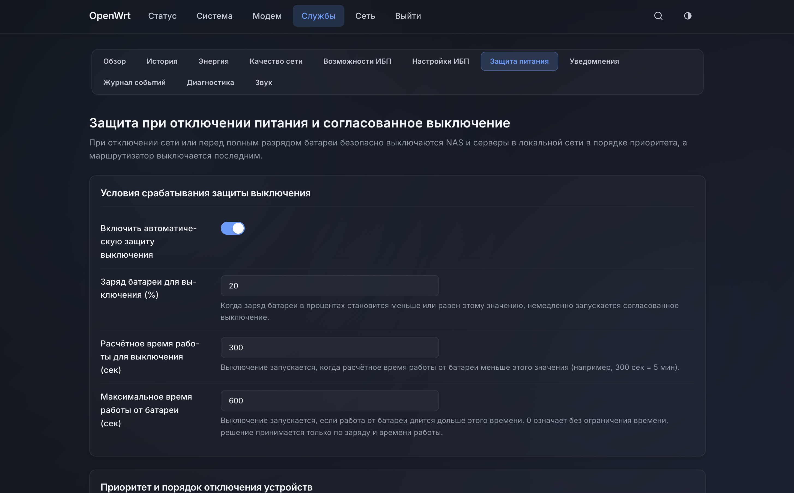
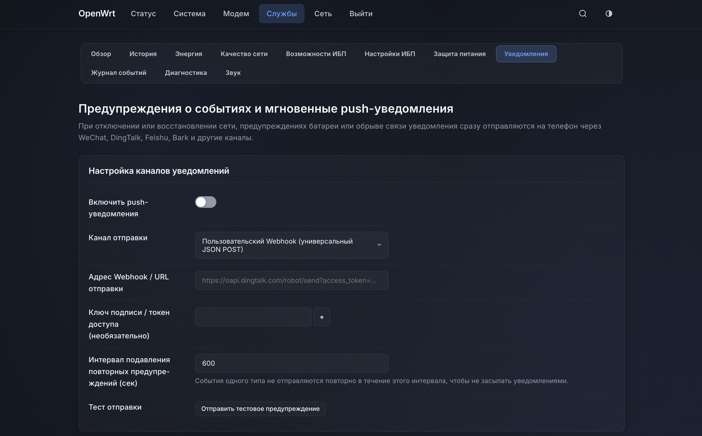
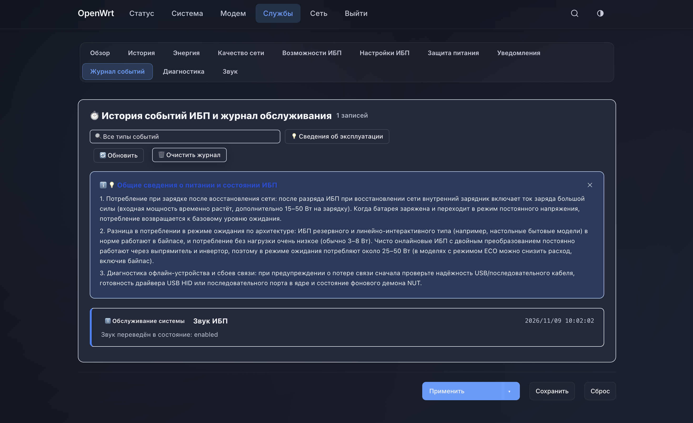
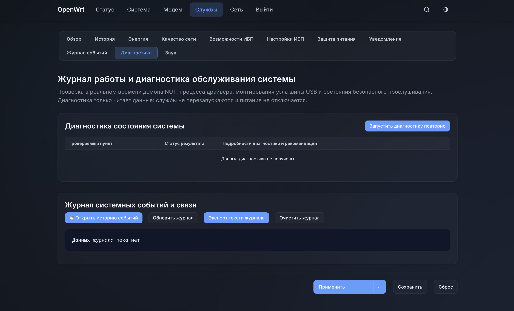

# UPS Manager (v1.0.1)

## О пакете (по-русски)

`luci-app-ups-manager` — веб-интерфейс LuCI для контроля источников бесперебойного питания (ИБП, UPS) на роутерах OpenWrt и iStoreOS. Пакет показывает состояние питания и батареи, историю и энергопотребление, качество электросети, отправляет уведомления о пропадании питания и может безопасно отключить роутер при разряде батареи.

Что умеет:
- обзор состояния ИБП и истории напряжения, частоты, нагрузки и заряда;
- журнал качества сети с порогами и правилами статуса (перегрузка, байпас, замена батареи, самодиагностика);
- управление звуковым сигналом ИБП: режимы «Обычный», «Выключить до перезагрузки», «Выключать постоянно» и «Расписание» (отключение и включение звука по времени);
- уведомления: WeChat Work, DingTalk, Feishu, Bark, Server酱 и произвольный Webhook;
- защита при отключении питания и выключение роутера по порогам.

**Проверено:** пакет проверен в работе с ИБП **Greencell UPSLP480 (750 VA, USB ID 0665:5161)**. Для других моделей и драйверов NUT поведение не проверялось.

**Звуковой сигнал ИБП и расписание** реализованы, но проверены только на **Greencell UPSLP480**. Отключение звука работает через команду NUT `beeper.toggle` от имени пользователя `admin`; на других ИБП команда или её поведение могут отличаться. Расписание хранит время выключения и включения звука и проверяет его каждые 2 минуты. Если звук на вашей модели не работает, управление можно отключить переключателем на вкладке «Звук» (или командой `uci set ups_manager.beeper.enabled=0 && uci commit ups_manager`): тогда пакет не отправляет на ИБП никаких команд звука.

**Важно:** это программное обеспечение распространяется «как есть» по лицензии GPL-2.0. Автор и участники не несут ответственности за работу оборудования, потерю данных, повреждение техники или последствия отключения питания. Перед использованием в важной сети проверьте настройки на своём оборудовании.

[](LICENSE)
[](https://openwrt.org)
[](https://istoreos.com)

**UPS Manager (`luci-app-ups-manager`)** — современная система управления ИБП (UPS) для **OpenWrt** и **iStoreOS**: веб-интерфейс LuCI, мониторинг, история, уведомления и безопасное отключение.

Построена на LuCI 2.0+ (клиентский JavaScript SPA) и использует NUT (Network UPS Tools). Подходит для домашних роутеров, небольших NAS, All-in-One и серверных комнат, где нужна защита от отключения питания и учёт энергопотребления.

---

## 📸 Скриншоты (UI Showcase)

### 1. Обзор ИБП (Overview Dashboard)
> Схема питания, заряд и время работы батареи, напряжение шины, состояние инвертора, нагрузка и связь с ИБП.


### 2. История питания (Historical Curves)
> Графики на чистом SVG без внешних библиотек: входное и выходное напряжение на одном экране, отключения питания отмечаются красной пунктирной линией.


### 3. Энергопотребление (Energy & Power Telemetry)
> Учёт накопленной энергии, измерение активной мощности и отметки оценочных значений. Удобно для расчёта затрат на электроэнергию.


### 4. Качество сети и оповещения (Power Quality & Outage Guards)
> Анализ напряжения и частоты на входе и выходе, гистерезис для защиты от дребезга и пороговые оповещения.


### 5. Возможности ИБП (Hardware Capability Map)
> Автоматически определяет и показывает все поля, которые сообщает ИБП. Только чтение, экспорт в JSON или текст.


### 6. Настройки ИБП (Hardware & Driver Settings)
> Встроенная база производителей, поиск USB/последовательных устройств и проверка связи с ИБП.


### 7. Защита питания и выключение (Outage Protection & Device Shutdown)
> Условия срабатывания защиты (остаток заряда, оценка работы, длительность отключения), порядок выключения устройств и задержки.


### 8. Уведомления (Notification & Alert Webhooks)
> Отправка событий в WeChat Work, DingTalk, Feishu, Bark и на произвольный Webhook, с защитой от повторов.


### 9. Журнал событий (Event Log & Telemetry Audit)
> Журнал событий питания (отключение сети, переход на батарею, восстановление) с фильтрацией по типу.


### 10. Диагностика (Diagnosis & Health Check)
> Самопроверка NUT, upsd, драйвера, USB и безопасности сетевых портов, просмотр журнала связи в реальном времени.


---

## 🌟 Основные возможности

1. **Автоматическое распознавание ИБП**
   - Сканирование USB и последовательных портов;
   - Определение VendorID (VID), ProductID (PID), серийного номера и описания устройства;
   - Встроенная база производителей (CyberPower, APC, Santak, Kehua, Eaton, Powercom и др.) с подбором драйвера NUT.
2. **Панель мониторинга LuCI (JS SPA)**
   - Отрисовка в браузере, адаптация под телефон, планшет и широкий экран;
   - Поддержка тем Argon и светлого/тёмного режима;
   - Общая сводка: состояние сети, заряд батареи, оценка времени работы, загрузка, мощность, напряжения и частоты, температура и связь с ИБП.
3. **Честные данные**
   - Показываются только поля, которые сообщает сам ИБП; неподдерживаемые пункты отмечаются как «не поддерживается»;
   - Реальная и оценочная мощность (номинальная × загрузка) помечаются отдельно, с указанием метода расчёта.
4. **История и графики**
   - Графики на чистом SVG без внешних библиотек;
   - Периоды 1, 6 и 24 часа, экспорт временных рядов в CSV;
   - Отключения сети выделяются на графике.
5. **Качество сети и гистерезис**
   - Оповещения о повышенном и пониженном напряжении с настраиваемым гистерезисом;
   - Контроль отклонения частоты и перегрева ИБП.
6. **Карта возможностей ИБП (только чтение)**
   - Все поля `upsc` с пояснениями, единицами измерения и категориями (измерено / сообщено / системное);
   - Экспорт исходных данных в текст и JSON;
   - На этом этапе команды, которые могут изменить состояние ИБП, не выполняются.
7. **Защита флеш-памяти роутера**
   - Частые замеры хранятся в оперативной памяти (`/tmp/run`, tmpfs);
   - Запись на флеш выполняется редко, сжатые данные сохраняются по расписанию.
8. **Защитное выключение при нескольких устройствах**
   - Срабатывает по времени без питания, остатку заряда или оценке работы;
   - Порядок выключения: сначала сетевые устройства (NAS, PVE, физические серверы), потом роутер;
   - Возможна отмена, если питание восстановилось;
   - Опасные действия (например, выключение выхода ИБП) требуют подтверждения.
9. **Уведомления**
   - Поддерживаются **WeChat Work**, **DingTalk**, **Feishu**, **Bark (iOS)**, **Server酱** и **универсальный Webhook**;
   - Отправляются события: отключение сети, восстановление, низкий заряд, перегрузка, потеря связи;
   - Токены и ключи скрыты в интерфейсе, есть защита от частых повторов.
10. **Диагностика**
    - Быстрая проверка NUT, состояния служб, драйвера, USB и безопасности сетевых портов.

---

---

## 📦 Структура проекта

```text
luci-app-ups-manager/
├── Makefile                               # Правила сборки OpenWrt
├── LICENSE                                # Лицензия GPL-2.0
├── README.md                              # Описание проекта
├── root/                                  # Файлы, которые ставятся в систему
│   ├── etc/
│   │   ├── config/ups_manager              # Конфигурация UCI
│   │   ├── init.d/ups-manager              # Служба procd
│   │   └── uci-defaults/80_ups_manager     # Первичная настройка при установке
│   └── usr/
│       ├── bin/
│       │   ├── ups-manager-daemon          # Опрос ИБП, фильтрация, кольцевой буфер
│       │   ├── ups-manager-notify          # Отправка уведомлений
│       │   └── ups-manager-shutdown        # Согласованное выключение устройств
│       ├── libexec/rpcd/luci.ups-manager   # Бэкенд ubus / rpcd
│       └── share/
│           ├── acl.d/luci-app-ups-manager.json     # Права доступа LuCI
│           └── luci/menu.d/luci-app-ups-manager.json # Меню LuCI
└── htdocs/luci-static/resources/view/ups-manager/
    ├── overview.js                        # Обзор
    ├── charts.js                          # История
    ├── energy.js                          # Энергопотребление
    ├── quality.js                         # Качество сети
    ├── capability.js                      # Возможности ИБП
    ├── settings.js                        # Настройки ИБП
    ├── shutdown.js                        # Защита питания
    ├── notification.js                    # Уведомления
    └── diagnosis.js                       # Диагностика и журнал
```

---

## 🛠️ Установка

Пошаговая инструкция с проверкой: **[INSTALL.md](INSTALL.md)**.

Кратко, для OpenWrt 25.x (apk):

```sh
apk update
apk add luci-base rpcd rpcd-mod-file curl \
  nut nut-common nut-server nut-upsmon nut-upsc nut-upscmd \
  nut-driver-usbhid-ups nut-driver-blazer_usb
apk add --allow-untrusted ./luci-app-ups-manager-*.apk
```

Файл `.apk` скачивается из последнего релиза: https://github.com/FE0D0T/luci-app-ups-manager/releases/latest

---

## 🔨 Сборка пакета

Сборка выполняется через SDK OpenWrt (нужна Linux-среда). Подробные шаги см. в разделе ниже.

### Вариант 1: SDK (рекомендуется)

Скачайте SDK для вашей версии OpenWrt и выполните:

```bash
# Клонировать форк в папку package SDK
git clone https://github.com/FE0D0T/luci-app-ups-manager.git package/luci-app-ups-manager

# Выбрать пакет в меню
make menuconfig
# Путь: LuCI -> Applications -> luci-app-ups-manager -> <M>

# Собрать только этот пакет
make package/luci-app-ups-manager/compile V=s
```

Готовый файл появится в `bin/packages/<архитектура>/` (для OpenWrt 25+ это `.apk`, для более старых версий — `.ipk`).

### Вариант 2: в исходниках OpenWrt

Положите репозиторий в `package/` исходников OpenWrt и выполните те же шаги `make menuconfig` и `make package/luci-app-ups-manager/compile V=s`.

---

## 🔒 Безопасность и отказ от ответственности

1. **Ограничение сети по умолчанию:** NUT-сервер по умолчанию слушает только `127.0.0.1`. Не открывайте его на `0.0.0.0` или WAN-порт без изоляции внутренней сети.
2. **Защита от случайного отключения:** отключение выходов ИБП опасно. Если сеть восстановится в этот момент, ИБП может остаться в режиме защиты и потребовать ручного включения. Включайте такие функции, только поняв последствия, и сначала проверьте их в тестовой среде.

---

## 📄 Лицензия

Проект распространяется по лицензии [GNU General Public License v2.0](LICENSE).
Замечания и предложения можно оставлять в Issues.
